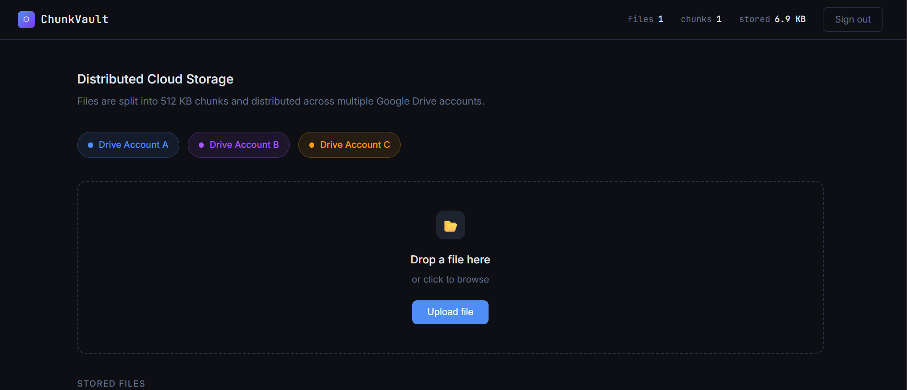
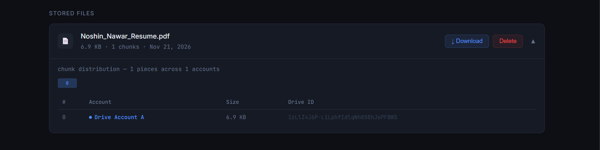

# ChunkVault

A web app that splits files into chunks and distributes them across multiple Google Drive folders — then reassembles them on download. Built with Python, Flask, and the Google Drive API.




---

## How it works

When a file is uploaded, it is split into 512 KB pieces. Each chunk is uploaded to a different Google Drive folder in round-robin order. The app stores the metadata (which chunk lives where) in a local SQLite database. On download, chunks are fetched in order and merged back into the original file.

```
Upload  →  split into 512 KB chunks
           Chunk 0  →  Drive Account A
           Chunk 1  →  Drive Account B
           Chunk 2  →  Drive Account C
           Chunk 3  →  Drive Account A  (repeats)

Download  →  fetch chunks in order  →  reassemble  →  original file
```

No single storage location holds the complete file.

---

## Features

- Google OAuth 2.0 login — uses the signed-in user's own Drive storage
- Files split at 512 KB boundaries and distributed round-robin across 3 folders
- Chunk visualization — each file row expands to show which chunk went where, with its Drive file ID
- Download reassembles all chunks in order
- Delete removes every chunk from Drive and clears the database entry
- Stats bar shows total files, chunks, and storage used

---

## Stack

- **Backend** — Python, Flask
- **Auth** — Google OAuth 2.0
- **Storage** — Google Drive API v3
- **Database** — SQLite
- **Frontend** — HTML, CSS, Vanilla JS (no framework)

---

## Local setup

### 1. Google Cloud Console

1. Go to [console.cloud.google.com](https://console.cloud.google.com) and create a project
2. Enable the **Google Drive API** (APIs & Services → Library)
3. Go to **Credentials** → **+ Create Credentials** → **OAuth 2.0 Client ID**
   - Application type: **Web application**
   - Authorized redirect URI: `http://localhost:5000/callback`
4. Download the JSON and rename it to `client_secret.json`, place it in the project root
5. Go to **Audience** → **Test users** → add your Gmail address

### 2. Google Drive folders

Create 3 folders in your Google Drive. Get each folder's ID from its URL:

```
https://drive.google.com/drive/folders/THIS_IS_THE_ID
```

### 3. Environment

```bash
cp .env.example .env
```

Fill in `.env`:

```
SECRET_KEY=any-random-string
FOLDER_ID_1=your_first_folder_id
FOLDER_ID_2=your_second_folder_id
FOLDER_ID_3=your_third_folder_id
```

### 4. Run

```bash
pip install -r requirements.txt
python app.py
```

Open `http://localhost:5000` → sign in with Google → upload a file.

---

## Project structure

```
chunkvault/
├── app.py                  # Flask backend — routes, chunking logic, OAuth
├── templates/
│   └── index.html          # Single-page frontend
├── Docs/
│   ├── screenshot.png
│   ├── screenshot-chunk.png
│   └── SETUP.md            # Detailed setup guide
├── storage.db              # SQLite — created on first run, not committed
├── client_secret.json      # OAuth credentials — not committed
├── .env                    # Environment config — not committed
├── .env.example
├── .gitignore
└── requirements.txt
```

---

## API routes

| Method | Route | Description |
|--------|-------|-------------|
| GET | `/` | Web interface |
| GET | `/login` | Start Google OAuth flow |
| GET | `/callback` | OAuth redirect handler |
| GET | `/logout` | Clear session |
| POST | `/upload` | Upload and chunk a file |
| GET | `/files` | List files with chunk metadata |
| GET | `/download/<hash>` | Reassemble chunks and download |
| DELETE | `/delete/<hash>` | Remove all chunks from Drive |
| GET | `/stats` | File count, chunk count, total size |

---

## Notes

This project uses three folders within one Google account to simulate distribution across multiple storage locations. In a production setup, each folder would belong to a separate Google account with independent credentials and storage quota.

The app runs in OAuth testing mode — only accounts added as test users in the Google Cloud Console can sign in while the app is unverified.